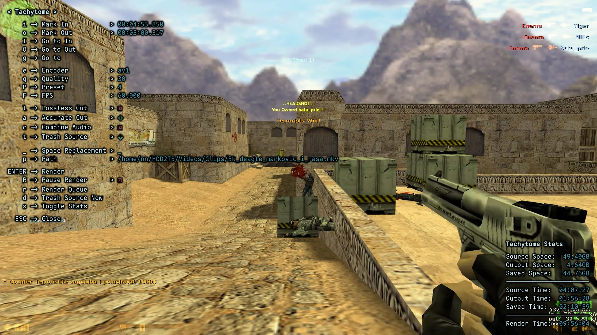

# Tachytome

Tachos (τάχος) – Speed<br>
Tome &nbsp;&nbsp;(τομή) &nbsp;– Cut

Keyboard Driven, AV1/H265/H264/Lossless, MPV Video Cutter.

<a href="https://youtu.be/PoyvYFPhrfI">
  
</a>

*Click the image to view a quick showcase of Tachytome capabilities.*

## Table of Contents

- [Why Tachytome?](#why-tachytome)
- [Installation](#installation)
  - [Installer](#installer)
  - [Dependencies](#dependencies)
  - [Clone](#clone)
  - [Submodule](#submodule)
  - [Upgrading](#upgrading)
- [Usage](#usage)
  - [Quickstart](#quickstart)
  - [Keymap](#keymap)
  - [Config](#config)
  - [Recovery](#recovery)
  - [Go To](#go-to)
  - [Resolution](#resolution)
  - [Tracks](#tracks)
  - [Effects](#effects)
  - [Path](#path)
- [Contributing](#contributing)
- [Donations](#donations)
- [AI](#ai)

## Why Tachytome?

Cutting clips was always an exhausting chore for me.<br>
I would clip something, navigate to it, open a video editor/cutting utility, drag and drop or paste the path, and so on.<br>
Now consider the fact I have ~1TB of clips.<br>
I built Tachytome to make cutting clips fun, easy and fast.<br>
You run into a good clip, and Tachytome is right there, ready to cut the important part with the settings of your choice.<br>
No more copying paths, no more external software with poor UX, it's all there, right in your video player.

## Installation

### Installer

The installer puts Tachytome in your mpv scripts dir and offers installing what's missing.

- Linux, Mac
```sh
curl -fsSL https://raw.githubusercontent.com/nnra6864/tachytome/master/install.sh | sh
```

- Windows (Powershell)
```sh
irm https://raw.githubusercontent.com/nnra6864/tachytome/master/install.ps1 | iex
```

- Installs into the dir mpv reads its config from, `$MPV_HOME`, `$XDG_CONFIG_HOME/mpv` or `~/.config/mpv`, the Flatpak dir when that's your only mpv, and `portable_config` next to `mpv.exe`, `$MPV_HOME` or `%APPDATA%/mpv` on Windows.
- Clones the release marked Latest on GitHub with git, offering to install git when it's missing, and downloads the release archive from GitHub otherwise.
- Offers installing FFmpeg, and gio or trash-cli on Linux, with your package manager, `brew` on Mac or `winget` on Windows.
- When Tachytome is already installed, it asks before reinstalling and moves the current install next to the scripts dir, your config is never touched.

To install manually instead, get the dependencies and clone the repo or add it as a submodule.

### Dependencies

- [ffmpeg](https://ffmpeg.org/) - needed for all the video operations.
- [gio](https://www.gtk.org/docs/architecture/glib)/[trash](https://github.com/andreafrancia/trash-cli) - needed on Linux for trashing files.

*gio is preinstalled on most distributions*

- Arch
```sh
sudo pacman -S ffmpeg
```

- Mac
```sh
brew install ffmpeg
```

- Windows
```sh
winget install -e --id Gyan.FFmpeg
```

### Clone

You may clone the repo directly to your config:

- Unix
```sh
git clone https://github.com/nnra6864/tachytome ~/.config/mpv/scripts/tachytome
```

- Windows (Powershell)
```sh
git clone https://github.com/nnra6864/tachytome "$env:APPDATA/mpv/scripts/tachytome"
```

### Submodule

If you are source controlling your dotfiles, consider adding Tachytome as a submodule:

- Unix
```sh
git submodule add ../../nnra6864/tachytome ~/.config/mpv/scripts/tachytome
```

- Windows (Powershell)
```sh
git submodule add ../../nnra6864/tachytome "$env:APPDATA/mpv/scripts/tachytome"
```

> [!NOTE]
> `../../` in the link makes git use the same server as your root repo.<br>
> For example, if your dotfiles are hosted on `https://github.com/name/dotfiles`, double `../` will make it go up twice in the URL, ending up with `https://github.com/`, and then appending `nnra6864/tachytome` to that, resulting in `https://github.com/nnra6864/tachytome`

### Upgrading

Tachytome remembers the version it last ran in the state dir, see [Recovery](#recovery).<br>
When a new version changes the config format, the first start after updating shows what will change and asks:

- **Migrate** converts your config, keeping the old files next to it with a `.bak` extension.
- **Skip, start fresh** uses the new defaults, keeping the old files as `.bak` too.
- **Later** asks again on the next start, using the defaults until then.

Updates that cross a major version, e.g. `2.4.1 -> 3.0.0`, are pointed out before installing.

#### 1.0.0 -> 2.0.0

- `mpv/script-opts/tachytome.conf` becomes `mpv/script-opts/tachytome/default.conf`, sourced by a new `tachytome.conf`.<br>
  Only options you changed from the 1.0.0 defaults are kept, `combine_audio`, `first_audio_only` and `combined_audio_name` become a [`tracks`](#tracks) chain, and options that no longer exist are dropped.
- Everyone moves to the new `default` menu, `selected_keymap` is dropped.<br>
  Your own keymaps become menus, e.g. `keymap mine ... end` turns into `menu mine { ... }`, with `ignore` becoming `none` and `base builtin` or `base default` becoming `base simple`, `base nested` becoming `base default`.<br>
  Keymaps named like a builtin menu get an `old_` prefix, and flat rebinds like `keymap r render` become `menu r render`.
- `mpv/script-opts/tachytome-effects.conf` is replaced by `.eff` files in `mpv/script-opts/tachytome/`, effects you added or changed go to `custom.eff`.
- Path history, stats and render queues move from `~/.local/share/tachytome` to `~/.local/state/tachytome` on Linux.
- A git install that 1.0.0's updater left on `master` switches to the latest release when that's the same commit.

#### 2.0.0 -> 2.1.0

- `combine_audio`, `combined_audio_only`, `combined_audio_name`, `audio_tracks` and `video_tracks` become one [`tracks`](#tracks) chain in the same config file, e.g. `audio_tracks=1,3` with `combine_audio=yes` becomes `tracks=keep 1,3 mix "Combined" at 1`, first like the old combined track.
- `combined_audio_name` moves into the mix, `Combined` when it wasn't set, so the track keeps its old title, e.g. `mix "Voice"`, and Combined Only becomes `keep @mixes`.
- Interrupted render queues are converted too, Skip leaves the old options in place, where they're ignored with a warning.
- A `default.eff` you never changed is replaced with the new one, its commented out examples become [disabled](#effects) effects, a changed one is left as it is.

## Usage

Tachytome is entirely keyboard driven.<br>
All the binds are isolated into a submap (Tachytome menu), which you can access by pressing `t` by default.<br>
This is done to avoid global bind conflicts.

### Quickstart

- `t` to open the Tachytome menu.
- `g` and type in `10` to go to 10 seconds of your video.
- `i` to mark in.
- `g` and type in `90%` to go to 90% of your video.
- `o` to mark out.
- `g` and `i`/`o` to make sure mark in and out are good.
- `p` to set the name of your video.
- `Enter` to start the render.
- `r` then `q` to access the render queue.

### Keymap

| Keybind | Action | Description              |
|---------|--------|--------------------------|
| t       | Menu   | Open the Tachytome menu. |
| nil     | Go To  | Open the Go To menu.     |
| nil     | Trash  | Trash current file.      |

Go To and Trash hide the Tachytome menu while they're open and bring it back where you left it once they close.<br>
They do nothing while another list, prompt or dialog is open, close it first.

#### Menu

The `default` menu groups related items into the Video, Audio and Settings submenus.<br>
Keys like `s-i` are pressed one after another, `s` then `i`.<br>
Esc steps back out of a partially typed key or a submenu, the title shows where you are, e.g. `< Tachytome / Video >`.<br>
The `simple` menu keeps every item on a single level, switch to it with `s-s` `m` or `selected_menu=simple`.

| Keybind | Action            | Description                                                                                  |
|---------|-------------------|----------------------------------------------------------------------------------------------|
| g       | Go To             | Go to a precise location in the video.<br>Learn more about [Go To](#go-to).                  |
| i       | Mark In           | Mark the start of the video.                                                                 |
| o       | Mark Out          | Mark the end of the video.                                                                   |
| s-i     | Set In            | Type in the Mark In, same input as [Go To](#go-to).                                          |
| s-o     | Set Out           | Type in the Mark Out, same input as [Go To](#go-to).                                         |
| <hr>    | <hr>              | <hr>                                                                                         |
| v       | Video             | Open the [Video](#video) submenu.                                                            |
| a       | Audio             | Open the [Audio](#audio) submenu.                                                            |
| T       | Tracks            | Pick the tracks kept in the output.<br>Learn more about [Tracks](#tracks-list).              |
| e       | Effects           | Select the effects applied to the output.<br>Learn more about [Effects](#effects).           |
| <hr>    | <hr>              | <hr>                                                                                         |
| p       | Path              | Set Output path.<br>Learn more about [Path](#path).                                          |
| _       | Space Replacement | Set the character to replace spaces with.                                                    |
| t       | Trash Source      | Toggle trashing of the source file on render completion.                                     |
| <hr>    | <hr>              | <hr>                                                                                         |
| Enter   | Render            | Start the render of the output file.                                                         |
| r-q     | Render Queue      | Open the render queue menu.                                                                  |
| r-p     | Pause Render      | Pause the current render and render queue.<br>Can only pause the render queue on Windows.    |
| d       | Trash Source Now  | Trash the source file.                                                                       |
| <hr>    | <hr>              | <hr>                                                                                         |
| s-s     | Settings          | Open the [Settings](#settings) submenu.                                                      |
| Esc     | Close             | Close the currently active menu.                                                             |

##### Video

| Keybind | Action       | Description                                                                                                   |
|---------|--------------|---------------------------------------------------------------------------------------------------------------|
| e       | Encoder      | Set the video encoder.                                                                                        |
| q       | Quality      | Set the video encoder quality parameter.                                                                      |
| f       | FPS          | Set the FPS of the video.                                                                                     |
| k       | Keyframes    | Set the keyframe interval, e.g. `120` frames or `2s`.<br>Empty matches the source, shown like `2s`.           |
| p       | Preset       | Set the video encoder preset parameter.                                                                       |
| r       | Resolution   | Set the output resolution.<br>Learn more about the [Resolution List](#resolution-list) and [Resolution](#resolution). |
| l       | Lossless Cut | Toggle the lossless cut option.                                                                               |
| a       | Accurate Cut | Toggle accurate cut.<br>Makes cuts millisecond precise, but may cause a slight delay before rendering starts. |

##### Audio

| Keybind | Action           | Description                                                                         |
|---------|------------------|-------------------------------------------------------------------------------------|
| e       | Audio Encoder    | Set the audio encoder, `copy` keeps the source audio.                               |
| b       | Audio Bitrate    | Set the bitrate, e.g. `128k`, shows the source or `Best`.<br>Empty resets it.       |
| c       | Combine Audio    | Mix the kept tracks into a first track, a trailing `mix at 1` in [Tracks](#tracks). |
| o       | Combined Only    | Keep only the mix, a trailing `keep @mixes`, turns Combine Audio on too.            |

##### Audio Export

End the [Path](#path) with an audio extension to export audio only, e.g. `clip.opus` or `clip.mp3`.<br>
Supported formats are `mka`, `opus`, `ogg`, `oga`, `m4a`, `mp3`, `aac`, `flac` and `wav`, video and subtitles are dropped.<br>
With the `copy` encoder the audio is copied when the format can hold it, otherwise it's re-encoded with the format's own codec, e.g. Opus for `.opus`, AAC for `.m4a`.<br>
The typed format also wins over a picked Audio Encoder it can't hold, e.g. the `mp3` encoder with `clip.opus` gives Opus.<br>
Audio is only re-encoded when needed: a codec the format can't hold, audio effects, a mixed track, a picked encoder or a set bitrate.<br>
Re-encoded audio keeps the source bitrate when the codec stays the same, otherwise it uses the highest quality, 256k per channel for Opus and AAC, 320k for MP3 and quality 10 for Vorbis.<br>
`opus`, `mp3`, `aac`, `flac` and `wav` hold a single track, the first mix, or the first kept track without one.<br>
Dropping every video track in the [Tracks](#tracks-list) list switches the default name to an audio format, so it's never re-encoded just to fit.<br>
A single kept track uses its own format, e.g. `.opus` for Opus, `.m4a` for AAC or `.flac` for FLAC, several tracks use `.mka`, Matroska for audio.<br>
Pick which audio tracks are exported in the [Tracks](#tracks-list) list.

##### Settings

| Keybind | Action   | Description                                                                                                         |
|---------|----------|---------------------------------------------------------------------------------------------------------------------|
| s       | Stats    | Toggle the Tachytome stats overlay.                                                                                 |
| m       | Menu     | Switch the menu, saved to your config.<br>Learn more about [Custom Menus](#custom-menus).                           |
| c       | Configs  | Enable, disable and reorder extra configs.<br>Learn more about [Configs](#configs).                                 |
| l       | Language | Switch the UI language, saved to your config.<br>Learn more about [Translations](#translations).                    |
| v       | Version  | Pick the version Update installs, saved to your config as `version`.                                                |
| U       | Update   | Update Tachytome to the picked version using git, falls back to the GitHub archive.<br>Restart mpv after updating.  |

The `version` option takes:
- `latest`, the default, the release marked Latest, or the highest version tag when there's no release.
- A branch name, e.g. `master`, following that branch.
- A full or partial version, pinning the highest version tag it matches, e.g. `3` for the newest 3.x.x, `2.1` for the newest 2.1.x, or `1.2.5` for exactly 1.2.5.

Version tags look like `v1.2.5` or `1.2.5`, others like `v2.0-rc1` are skipped.<br>
Version lists `latest`, the branches and every release with its partial versions.<br>
A git clone reads them from the remote of the current branch, or `origin` when it's detached at a release, and asks that remote's host which release is Latest.<br>
GitHub and Forgejo/Gitea hosts are supported, other hosts fall back to the highest version tag.<br>
Without git, everything comes from the GitHub repo.<br>
Updating through git switches the checkout to the branch, or detaches it at the release.

#### Render Queue

| Keybind | Action        | Description                                                                                |
|---------|---------------|--------------------------------------------------------------------------------------------|
| Enter   | Pause Render  | Pauses the current render and render queue.<br>Can only pause the render queue on Windows. |
| p       | Change Path   | Change output path.                                                                        |
| d       | Delete        | Deletes the item from the render queue.                                                    |

#### Go To Prompt

| Keybind | Action    | Description                        |
|---------|-----------|------------------------------------|
| i       | Go To In  | Go to Mark In, no Enter required.  |
| o       | Go To Out | Go to Mark Out, no Enter required. |
| Enter   | Go To     | Go to the typed in location.       |

#### Text Inputs (Path, Quality, Go To etc.)

| Keybind              | Action      | Description                             |
|----------------------|-------------|-----------------------------------------|
| Left/Right           | Move        | Move the cursor by one character.       |
| ctrl+Left/ctrl+Right | Move Word   | Move the cursor by one word.            |
| Home/End             | Start/End   | Jump to the start or end of the text.   |
| Backspace            | Delete      | Delete the character before the cursor. |
| ctrl+Backspace       | Delete Word | Delete the word before the cursor.      |

Inputs show the current value and a hint on the accepted format below the prompt.<br>
Submitting an empty input resets to the default where there is one, e.g. the source FPS for FPS or the default path for Path, otherwise it keeps the current value.<br>
Esc closes any prompt or dialog without changing anything.

Words end at whitespace and separators like `-`, `_`, `/`, `\`, `.`, `,`, `:`, `;` and brackets, e.g. ctrl+Backspace on `~/Videos/my_clip` leaves `~/Videos/my_`.<br>
The cursor is a bar by default, set `cursor_style` to `bar`, `underline` or `block` to change it.<br>
It's drawn above the text, the block also redraws the character under it on top, in the inverse of the cursor color by default.<br>
See the `cursor_` options in the [builtin config](./tachytome.conf) for its colors and glow.

#### Path

| Keybind     | Action   | Description                                              |
|-------------|----------|----------------------------------------------------------|
| Up/ctrl+k   | Previous | Select previous item in history, cursor goes to its end. |
| Down/ctrl+j | Next     | Select next item in history, cursor goes to its end.     |

#### Lists (Render Queue, Preset etc.)

| Keybind     | Action        | Description                                     |
|-------------|---------------|-------------------------------------------------|
| Up/k        | Navigate Up   | Navigates to item above, the top wraps around.  |
| Down/j      | Navigate Down | Navigates to item below, the bottom wraps around. |
| 0-9         | Select        | Selects the item number, `0` is the 10th.       |
| /           | Search        | Search the list by name.                        |

Every menu lists its keys under Keys, moving around on the first line, the menu's own actions on the second and Tab, Enter and Esc last, each always in the same spot.<br>
Number keys are shown next to the first 10 items of lists that have them, the rest are reached with Up/Down.<br>
Lists put what's rarely needed last, so with wrapping it's only a few Up presses away from the top.<br>
Lists you toggle things in, Effects, Configs and the tracks picker, all work the same way:
- Tab toggles the item under the cursor, and number keys toggle by number where the list has them.
- Enter applies the changes and closes the list.
- Esc cancels, putting back everything as it was when the list opened.

The Resolution and Tracks Lists hold rows you open, so Enter edits the row, and Esc closes keeping what you changed, since each edit already has its own Enter and Esc.<br>
Their toggles work with Tab too, and Enter on a toggle row closes the list.<br>
Loading another file while they're open redraws them for it, a tracks picker or prompt from the old file goes back to the Tracks List of the new one, a Resolution prompt stays and shows sizes for the new file.<br>

Search opens a `/` line under the list title, the list stays and hides what doesn't match as you type, ignoring case, then:
- Enter with one match, or one exact name, selects it, e.g. `/av1` picks `av1` even though `nv_av1` also matches.
- Enter with several matches stops typing and keeps them shown, numbered from 1, to pick with the usual keys.
- Up/Down stop typing and move through the matches.
- Esc while typing, or on the kept matches, clears the search and shows the whole list again.

Selecting a match picks it, toggles the effect, config or a preset in the Preset Manager, uses the resolution or track preset, or moves to the render.<br>
Configs can't be moved until the search is cleared.<br>
Effects are searched as `file/name`, so `/default` lists one file's effects and `/fade` picks `fade`.<br>
The Resolution and Tracks Lists have no search, their rows are your own few layers and tracks, their Presets lists do.<br>
Inputs like the Path prompt use ctrl+k/ctrl+j instead, since plain letters are typed into the input.

#### Effects List

| Keybind | Action | Description                                         |
|---------|--------|-----------------------------------------------------|
| Tab     | Toggle | Select or deselect the preset, or toggle Effects.   |
| d       | Edit   | Edit the duration and params of the preset.         |
| m       | Manage | Open the [Preset Manager](#preset-manager).         |
| Enter   | Apply  | Keep the changes and close the list.                |
| Esc     | Cancel | Put the effects back as they were and close.        |

#### Resolution List

| Keybind      | Action    | Description                                                              |
|--------------|-----------|--------------------------------------------------------------------------|
| Tab          | Toggle    | Turn Resolution on or off on the toggle row.                             |
| Enter        | Edit      | Type the chain, open Presets or replace the selected layer.              |
| a            | Add       | Add layers after the selected one, or at the end.                        |
| p            | Presets   | Open the Presets list from any row.                                      |
| m            | Mode      | Pick the layer's mode from a list, Default follows `resolution_mode`.    |
| s            | Scaler    | Pick the layer's scaler from a list, Default follows the scaler options. |
| d            | Delete    | Delete the layer.                                                        |
| Shift+Up/K   | Move Up   | Move the layer up, before the one above.                                 |
| Shift+Down/J | Move Down | Move the layer down, after the one below.                                |
| Esc          | Close     | Close the list.                                                          |

The title shows the source and output size, the chain's layers are listed under Layers, each with its mode and the scaler it uses.<br>
Hovering a layer previews it, the title shows the size after that layer, e.g. `After 0.5x: 1920x1080 -> 960x540`.<br>
With `layer_preview=no` the title keeps the output size and each layer shows the size it goes from and to instead.<br>
The Chain row, the whole chain as one line, sits under the layers.<br>
Modes and scalers set on the layer are highlighted, the rest come from the defaults, `-` means it doesn't apply.<br>
The Presets row shows the [preset](#resolution-presets) in use, its list shows each preset's chain and the size it gives, numbered and searchable like the other lists.<br>
In it 0-9/Enter replaces the whole chain with the preset and puts the cursor on it, `a` adds it after the selected layer or at the end, `m` opens the [Preset Manager](#preset-manager) and `n` [saves the chain](#saving-presets) as a new preset.<br>
With no presets left the list says so, `m` and `n` still work there.<br>
The inputs show the resulting size while typing and share a history kept across restarts, an input can hold several layers, e.g. `5:4 crop 0.5x`.<br>
Setting a chain or using a preset turns Resolution on, an empty Chain keeps the source.<br>
Layers added with `a`, or with `a` in the Presets list, get the cursor.

#### Tracks List

| Keybind      | Action    | Description                                                              |
|--------------|-----------|--------------------------------------------------------------------------|
| Tab/0-9      | Toggle    | Keep or drop the track under the cursor, or with that number.            |
| Enter        | Edit      | Open the layer's picker, type the chain or open Presets, a track closes. |
| a            | Add       | Add a layer after the selected one, or at the end.                       |
| p            | Presets   | Open the Presets list from any row.                                      |
| e            | Type      | Type the selected layer, replacing it.                                   |
| r            | Rename    | Rename the track or mix, empty restores its own name.                    |
| o            | Position  | Move the track to a position, or set the mix's output position.          |
| d            | Delete    | Delete the layer.                                                        |
| Shift+Up/K   | Move Up   | Move the layer or track up, before the one above.                        |
| Shift+Down/J | Move Down | Move the layer or track down, after the one below.                       |
| v            | Video     | Show the video tracks.                                                   |
| Esc          | Close     | Close the list.                                                          |

The list shows your [`tracks`](#tracks) chain in two parts, updating live as you change it:
- **Tracks**, the ones the chain leaves before its trailing Combine Audio `mix` and `keep @mixes`, toggling one drops or restores it through a trailing `drop` layer, so Combine Audio mixes the ones that are on.
- **Layers**, a `!` marks the layer that fails.

Hovering a layer previews it in place of Tracks, titled e.g. `After mix -2`, listing the tracks left after that layer in order, with where each one comes from, e.g. `source 1` or `mix Desktop+Mic`.<br>
Hovering the last layer shows what gets rendered, moving back up to Tracks brings the toggles back.<br>
With `layer_preview=no` Tracks always stays, and each layer shows its result next to it instead, a mix the tracks it mixes, e.g. `mix -2 -> Mix = Desktop+Mic`, the rest the tracks left after it.<br>
A layer added with `a` gets the cursor once it's kept.<br>

The Chain row, the whole chain as one line, sits under the layers.<br>
The Presets row under it shows the [preset](#track-presets) in use, its list shows each preset's chain and the `in > out` it gives, numbered and searchable like the other lists.<br>
In it 0-9/Enter replaces the whole chain with the preset, `a` adds it after the selected layer or at the end, either way it gets the cursor, `m` opens the [Preset Manager](#preset-manager).<br>
With no presets left the list says so, `m` still works there.<br>
A preset is one layer in the list, hovering it shows the tracks after all of its layers, Enter or `e` types it, a mix from it is renamed through a `rename` layer.<br>

The title shows how many tracks go in and out, e.g. `3 in > 1 out`.<br>
Each track shows its title, codec, channels or size and language, mixes show the tracks they're mixed from.<br>
Tracks and mixes are numbered by their position, the number the chain uses there, so with `drop 2` before them the file's third track is 2.<br>
`0` is the 10th track, tracks past it have no number key, reach them with Up/Down and toggle them with Tab.<br>
`o` on a track, mixes included, adds it to a `move` layer right before the Combine Audio tail, e.g. `move 3 at 1` puts track 3 first, empty takes it out again, the layers after it are renumbered so they keep the same tracks.<br>
Shift+Up/Down on a track moves it one place the same way, the `move` layer is rewritten with as few moves as give that order.<br>
`a` offers `mix`, `keep`, `drop` and `move`, or Type... to write layers yourself, a picked layer opens its picker right away.<br>
`r` on a track adds it to a `rename` layer right before the Combine Audio tail, on a mix it renames the mix, and later layers using the old name follow it.<br>
Rename and the mix's name share a history of names you've used, Up/Down in the prompt goes through it.<br>
The tracks picker lists the tracks present at that layer, Tab/0-9 toggles one, ON is what stays for `keep` and `drop` and what's mixed for `mix`:
- `keep` writes the ones that are on, e.g. `keep 1,3`, and `keep all` when they all are.
- `drop` writes the ones that are off, e.g. `drop 2`, which keeps working on files with more tracks.
- `mix` starts on Include, writing the ones that are on, `m` switches to All except, writing the ones that are off, e.g. `mix -2`, `r` renames the mix and `o` sets its output position.
- All mixes and All sources under the tracks pick the whole group, writing `@mixes` or `@sources`, toggling one of its tracks after that picks the rest of the group one by one, they're hidden in All except.
  They show ON whenever every track of the group is, toggling one then turns the whole group off.

Its `in > out` count updates as you pick, Enter keeps the picks, Esc cancels them, and cancels the layer too when `a` just added it.<br>
A `move` layer opens the move picker instead, listing the tracks in the order the layer leaves them, a moved one showing where it was, e.g. `was 3`.<br>
`o` there moves the track under the cursor to a position, empty puts it back, Shift+Up/Down moves it one place, the layers after it are renumbered so they keep the same tracks, Enter keeps the moves and Esc cancels them.<br>
The chain and layer inputs show the result while typing and share a history kept across restarts.<br>
`v` shows the video tracks as a plain toggle list, `a` goes back to audio, set `tracks_type=video` to open on video.<br>
Only the file's own tracks are listed, external audio files loaded into mpv aren't part of the render, dropping every video track renders audio only.

#### Preset Manager

| Keybind | Action | Description                                                  |
|---------|--------|--------------------------------------------------------------|
| Tab/0-9 | Toggle | Enable or disable the preset under the cursor, or by number. |
| d       | Delete | Delete the preset.                                           |
| u       | Undo   | Bring back the preset you just deleted, for 5 seconds.       |
| Esc     | Back   | Go back to the list it was opened from.                      |

`m` in the Resolution and Tracks Presets lists and in the Effects List opens it, listing every preset of that kind, the disabled ones too, under the file it's in, each with ON or OFF, and the chain for resolution and track presets.<br>
It's numbered and searchable like the other lists, searched as `file/name`.<br>
Every change is written to the file right away, so there's no Enter to apply, Esc just goes back.<br>
- Toggling adds or removes [`disabled`](#resolution-presets) in front of the preset's line, the rest of the file stays as it is.
- Deleting removes the preset's lines, an effect's whole block, and its comment above when the comment and the preset stand alone between blank lines, so a comment over a group of presets stays.
- A file left with no presets, enabled or disabled, is deleted, `default.res`, `default.trk` or `default.eff` gets generated again on the next start when a kind has no files left.
- Undo puts the file back as it was, the deleted file too, unless it changed since, and works until the manager closes or 5 seconds pass.
- A file changed outside Tachytome while the manager is open is read again instead of written, the change is skipped with a warning.
- An effect that gets disabled or deleted is deselected, a chain using a disabled or deleted preset says so when it's used.

#### Saving Presets

`n` in the Resolution Presets list saves the chain you have now as a [preset](#resolution-presets), without editing any file yourself:
1. **Name**, checked as you type, it can't hold spaces, `=`, `/` or `#`, be a size, mode or scaler, or be used in the chain itself.
2. **File**, one of your `.res` files, the one you saved to last listed first, or New file... to type a name for a new one.
   A file that already has a preset by that name shows `replaces` and its chain, picking it asks before replacing it.
3. **Description**, optional, written as a `#` comment above the preset, replacing keeps the preset's own comment when left empty.

A new preset goes at the end of the file after a blank line, a replaced one is rewritten in place and turned on if it was disabled.<br>
Presets used in the chain are saved by name, so the new one follows them when they change.<br>
Esc goes back a step, Esc on the name goes back to the Presets list.

#### Configs List

| Keybind      | Action    | Description                                 |
|--------------|-----------|---------------------------------------------|
| Tab          | Toggle    | Enable or disable the config.               |
| Shift+Up/K   | Move Up   | Move the config up, before the one above.   |
| Shift+Down/J | Move Down | Move the config down, after the one below.  |
| Enter        | Apply     | Save the changes to your config and reload. |
| Esc          | Cancel    | Close without changing anything.            |

### Config

You can configure Tachytome with the `mpv/script-opts/tachytome/default.conf` file.<br>
It should get automatically generated on the first launch, with every line commented out.<br>
Uncomment and change only what you need, everything else uses the [builtin config](./tachytome.conf).<br>
The builtin config contains detailed explanations of all the settings, I would highly suggest reading it.

`mpv/script-opts/tachytome/tachytome.conf` is generated too, containing only `configs=default`, which picks the [configs](#configs) that get used.

A deleted `default.conf` is generated again on start when `default` is enabled in `configs`, or when there are no other `.conf` files next to `tachytome.conf`.

> [!NOTE]
> Coming from 1.0.0, which used `mpv/script-opts/tachytome.conf`? See [Upgrading](#upgrading).

To access exposed Tachytome functions, add the following to your `mpv/input.conf`:
```
t script-binding tachytome/menu
g script-binding tachytome/goto
d script-binding tachytome/trash
```
Replace `t`, `g` and `d` with keys of your choice.

#### Configs

`mpv/script-opts/tachytome/` can hold more `.conf` files next to `default.conf`, e.g. `work.conf` and `stream.conf`, picked with the `configs` option in `tachytome.conf`:
```
configs=default,work,stream,!old
```

- Configs are named without `.conf`, later ones override earlier ones.
- `!name` disables a config while keeping its place in the list.
- Lines in `tachytome.conf` above the `configs=` line apply before the configs, lines below it override them.
- Configs can set options and define [menus](#custom-menus), `configs` itself only works in `tachytome.conf`.
- `.conf` files in the dir that aren't listed show up as disabled.
- Switch them from the menu with `c` in Settings, which writes the `configs=` line and reloads options and menus.<br>
  Options changed from the menu during the session are reset to the config values on reload.
- Switching the menu, language or version from the menu saves it to whichever file sets it, e.g. `work.conf` when it's the one that wins.<br>
  When no file sets it yet, it goes to the first enabled config.

#### Custom Menus

The Tachytome menu is fully configurable through menus in your configs, e.g. `default.conf`.<br>
Pick the active one with `selected_menu`, or switch it from the menu with `m`.

```
menu mine {
    i   mark_in
    o   mark_out
    s-i set_mark_in Set In

    v-e encoder
}
```

| Line                      | Meaning                                                                         |
|---------------------------|---------------------------------------------------------------------------------|
| `menu <name> {`           | Starts a menu, closed with `}`.                                                 |
| `<keys> <action>`         | Bind a key to an action. Chain keys with `-`, e.g. `v-e`, to make nested binds. |
| `<keys> <action> <label>` | Same, with a custom label.                                                      |
| `hide <keys> <action>`    | Bind a key to an action without showing it in the menu list.                    |
| `<keys> <id> {`           | Starts a [submenu](#submenus), closed with `}`.                                 |
| empty line                | Separator.                                                                      |

Hidden items keep working from their keys.<br>
A hidden submenu, e.g. `hide s-s settings {`, still opens and shows its items, only its row is gone from the parent list.

Labels starting with `@` are [translation](#translations) keys, e.g. `@menu_set_mark_in Set In`, with the rest used as the fallback.<br>
Use `@@` for a label that starts with `@`.

##### Submenus

A line ending in `{` opens a submenu, its items go inside and it's closed with `}`:

```
menu mine {
    i mark_in

    v video {
        e encoder
        q quality
    }
    s-s settings Options {
        m menu_preset
        x extras {
            s stats
        }
    }
}
```

- The key opens the submenu, Esc goes back to the parent.
- The id names the submenu, e.g. `video`, so it can be patched and [translated](#translations) through `submenu_<id>`.
- An optional label after the id, e.g. `Options`, replaces the translation, use `@key Fallback` to keep it translatable.
- Submenus nest, the menu title shows the path, e.g. `< Tachytome / Options / Extras >`, joined with `menu_path_separator`.
- Submenus without any bound items are dropped from the list.

##### Base

Use `base` to build a menu on top of another one, the lines below then patch it:

```
menu nested {
    base default

    s-i set_mark_in
    add x mark_in
    t none
    s-s hide
}
```

| Line                  | Meaning                                                             |
|-----------------------|---------------------------------------------------------------------|
| `base <name>`         | Start from another menu instead of an empty one.                    |
| `<keys> <action>`     | Rebind an item, it keeps its place.<br>New items go at the end.     |
| `add <keys> <action>` | Add another key to an item, shown as `i,x -> Mark In`.              |
| `<keys> none`         | Unbind a key, `ignore` works too.                                   |
| `<keys> hide`         | Hide the item bound to a key from the list, its keys keep working.  |

- `hide` also works on patch lines and together with `add`, e.g. `add hide x mark_in` adds a key and hides the item.
- Patching an action finds it anywhere in the tree, e.g. `Q quality` rebinds Quality inside the Video submenu, keeping it there.
- `<keys> <id> {` patches an existing submenu, rebinding its key, the lines inside patch its items:
  ```
  v-v video {
      Q quality
      x none
  }
  ```
- `<keys> none` and `<keys> hide` only affect keys of the level they are on, use a submenu block to reach keys inside it.
- When an action appears more than once in the tree, the first one is patched with a warning.
- A menu with the same name as a builtin one replaces it.
- A single line `menu <keys> <action>` outside of any block patches whichever menu is selected.
- If a key is bound on its own, any nested binds starting with it are unreachable and will be ignored with a warning.

Actions are named after menu items in snake_case, e.g. `mark_in`, `goto`, `render_queue`, `trash_source_now`.<br>
See the `default` menu in the [builtin config](./tachytome.conf) for the full list.

#### Translations

Every UI string comes from a language file in the [`lang`](./lang) dir, e.g. `lang/en.lua`.<br>
Ships with English (`en`) and Serbian (`sr`, Latin script).<br>
Pick one with the `language` option, or switch it from the menu with `l`, which saves it to your config.<br>
`auto`, the default, detects the system language on every start, any other value forces that language.

- Linux/BSD read the `LC_ALL`, `LC_MESSAGES` and `LANG` env vars, in that order.
- macOS reads the same env vars when launched from a terminal, otherwise `defaults read -g AppleLanguages`.
- Windows asks PowerShell for `(Get-UICulture).Name` in the background, the UI switches once it answers.
- A detected `sr_RS.UTF-8` or `sr-Latn-RS` tries the most specific language file first, e.g. `sr_RS`, `sr-RS`, then `sr`.
- When nothing matches an available language, English is used.
- The menu shows the detected language next to `auto`, e.g. `auto (sr)`.

A language file returns a flat table of keys and their text:

```lua
return {
    menu_mark_in     = "Mark In",
    submenu_settings = "Settings",
    value_set        = "{label}: {value}"
}
```

- Keys missing from a language fall back to [English](./lang/en.lua), so a translation can be partial.
- `{name}` placeholders get replaced with values, keep them as they are, their order can change.
- Submenus are labeled by `submenu_<id>`, e.g. `submenu_video`, or their capitalized id when there's no such key, e.g. `my_stuff` shows as `My stuff`.
- Menu item labels, `menu_<action>`, are reused as the titles of the screens they open and in their notifications, e.g. `Quality: 30`.
- Key tooltips are built from `key_hint`, e.g. `{keys} to {action}`, and one `key_<action>` per action, e.g. `key_navigate`.
- To add a language, copy `lang/en.lua` to `lang/<code>.lua` and translate the text.

### Recovery

Tachytome gracefully handles crashes and accidental closes.<br>
Render queues are stored as files tied to the mpv PID, in the state dir: `$XDG_STATE_HOME/tachytome` or `~/.local/state/tachytome` on Linux, `~/Library/Application Support/tachytome` on Mac and `%LOCALAPPDATA%/tachytome` on Windows.<br>
The path history and the installed version live there too.<br>
Every time you start a new mpv instance, the script checks if any of these are present without an active mpv instance.<br>
It then asks you whether you want to recover, discard or ignore the queue.

### Go To

Tachytome includes a really powerful Go To implementation.<br>
On top of many input types, it also supports relative jumps.

#### Prefix

You can prefix `+` or `-` to make go to relative to the current time.

#### HH:MM:SS.MS

This is arguably the most versatile format as you can do `30` to go to 30 seconds, but also `1:2.50` to go to 1 minute 2 seconds 500 milliseconds.

#### Suffix

This is a convenient format to jump across minutes, hours etc.<br>
Instead of having to type `1:0`, you simply type `1m` to go to 1 minute.

| Suffix | Value       |
|--------|-------------|
| ms     | millisecond |
| s      | second      |
| m      | minute      |
| h      | hour        |
| d      | day         |
| f      | frame       |
| %      | percent     |

#### In/Out

Press `i` or `o` inside the Go To prompt to instantly jump to Mark In or Mark Out.<br>
Their current values are listed right below the input.

#### Examples

| Input  | Goes To             |
|--------|---------------------|
| `+30`  | 30 seconds ahead    |
| `2:0`  | 2 minutes           |
| `1:13` | 1 minute 13 seconds |
| `3m`   | 3 minutes           |
| `50ms` | 50 milliseconds     |
| `-60f` | 60 frames back      |
| `5%`   | 5%                  |

### Resolution

The `resolution` option sets the chain you start with, layers applied in order, empty keeps the source.<br>
It defaults to `auto` with `resolution_enabled` off, so turning Resolution on crops black bars right away.<br>
Change it on the fly in the [Resolution List](#resolution-list), Video > Resolution.<br>
It's applied while `resolution_enabled` is on, which stays on across files like Effects, and is incompatible with Lossless Cut, turning either on turns the other off.<br>
Each size token starts a new layer, a mode or scaler word right after it applies to that layer.

| Token          | Layer                                               |
|----------------|-----------------------------------------------------|
| `0.5x`, `50%`  | Multiplier, keeps the aspect.                       |
| `1920x1080`    | Box, how the frame gets into it is set by the mode. |
| `1280w`        | Width, keeps the aspect.                            |
| `720h`         | Height, keeps the aspect.                           |
| `720p`         | Short side, keeps the aspect, so vertical works.    |
| `4:3`          | Aspect, keeps the res, the box depends on the mode. |
| `halfres`      | A [preset](#resolution-presets), expands in place.  |
| `auto`         | Crops black bars, see [Auto Crop](#auto-crop).      |

An aspect is the largest box of it inside the frame for `cover` and `crop`, the smallest one around it for `fit`, and keeps the height for `stretch`.

| Mode      | Description                                                                 |
|-----------|-----------------------------------------------------------------------------|
| `fit`     | Scales the frame to fit inside, pads the rest with `pad_color`. Default.    |
| `cover`   | Scales the frame to cover it, crops what's left over from the center.       |
| `stretch` | Scales to the exact size, ignoring the aspect.                              |
| `crop`    | Cuts the center out without scaling, can't be bigger than the frame.        |

Scalers are `lanczos`, `spline`, `bicubic`, `area`, `bilinear`, `neighbor`, `fast_bilinear`, `bicublin`, `gauss` and `sinc`.<br>
Layers without one use `scaler_down` when they shrink the frame and `scaler_up` when they grow it, both `lanczos` by default.<br>
`resolution_mode` sets the mode for layers without one, modes only matter for boxes and aspects.<br>
Sizes are rounded to even numbers for encoders that need it, `av1` and `nv_h264` keep odd sizes, the chain runs before the effects.

| Chain               | 1920x1080 source                                                                  |
|---------------------|-----------------------------------------------------------------------------------|
| `0.5x`              | 960x540.                                                                          |
| `720p`              | 1280x720.                                                                         |
| `5:4 crop 0.5x`     | Cuts the side bars off a stretched 5:4 game, then halves it to 675x540 with av1.  |
| `1080x1920 cover`   | Vertical 1080x1920, cutting the sides off.                                        |
| `1080x1920`         | Vertical 1080x1920, the whole frame with bars above and below.                    |
| `4:3 stretch`       | 1440x1080, squeezed.                                                              |
| `200% neighbor`     | 3840x2160, keeping hard pixel edges.                                              |

Recorders that stretch a lower game res over the whole screen, e.g. 1280x1024 recorded as 2560x1440, are undone with `1280x1024 stretch`, which gives back the native frame.<br>
Use `1024p` instead to keep it looking the way it did on screen.<br>
`auto` doesn't help there, those recordings have no black bars, the game is stretched over the whole frame.

#### Auto Crop

`auto` finds black bars with ffmpeg's `cropdetect` and cuts them off, e.g. a 4:3 game recorded with side bars, or a letterboxed movie.<br>
- It samples 8 spots spread over the cut range, never just its start, and keeps the box that fits all of them, so a dark scene can't cut into the picture.
- Fully black moments, like fades, are ignored.
- Bars thinner than 0.5% of the frame are left alone.
- Detection starts as soon as Resolution is on with `auto` in the chain, the layer shows `detecting...`, then the size or `no bars`, while off it shows `detects when on`.
- Results are kept per file and cut range, moving a mark detects again, and so does turning Resolution off and on, to retry a bad result.
- A render waits for a running detection before it starts.
- Mode and scaler don't apply, put `auto` first, e.g. `auto 720p`, it measures the bars on the source.

#### Resolution Presets

Presets are named chains in `.res` files in `mpv/script-opts/tachytome/`, `default.res` gets generated when there are none.<br>
Every `.res` file is read in alphabetical order, one preset per line as `name = chain`, `#` starts a comment:
```
fhd      = 1080p
vertical = 1080x1920 cover
cs       = 1280x1024 stretch
disabled 4k = 2160p
```
- A preset name works anywhere in a chain, e.g. `fhd`, `cs 0.5x` or `vertical`, and can use other presets.
- A mode or scaler right after a preset applies to all of its layers, e.g. `vertical fit` or `4k neighbor`.
- Names ignore case and can't hold spaces, `=` or `/`, or be a size, mode or scaler.
- The same name in two files is fine, `file/name` picks a specific one, e.g. `mine/vertical`, a bare name picks the first file.
- The Resolution List opens them with `p` or the Presets row, 0-9/Enter uses one, `a` adds it to the chain, `n` saves the chain as one.
- `disabled` before a preset turns it off, e.g. `disabled vertical = 1080x1920 cover`, removing it turns the preset back on.<br>
  A disabled preset isn't listed, a bare name skips it for the next file that defines it, and using it says it's disabled.

`default.res` holds `autocrop` and `halfres`, with disabled examples to turn on: `hd` to `8k` on the short side, `vertical` and `cs`.

### Tracks

The `tracks` option sets the chain every loaded file starts with, layers applied in order, empty keeps every track.<br>
Each layer works on the tracks the ones before it left, an op word starts a new layer.<br>
Change it on the fly in the [Tracks List](#tracks-list) and with Combine Audio and Combined Only in Audio.

| Layer                         | Does                                                                       |
|-------------------------------|----------------------------------------------------------------------------|
| `keep <list>`                 | Keeps only these tracks.                                                   |
| `drop <list>`                 | Drops these tracks.                                                        |
| `mix [list] ["name"] [at N]`  | Adds a track mixed from the list, or from the kept tracks without one.     |
| `rename <track> "name" ...`   | Sets the title of tracks or mixes, e.g. `rename 1 "Game" 3 "Mic"`.        |
| `move <track> at N ...`       | Moves tracks or mixes to position N, shifting the rest.                    |
| `video <list>`                | The video tracks kept, dropping all of them renders audio only.            |
| `combined`                    | A [preset](#track-presets), runs its layers in place.                      |

- Lists are comma separated track numbers or names, `all` or `none`, e.g. `1,3` or `Voice,4`.
- `@mixes` and `@sources` are the mixes and the file's own tracks present at that layer, so `keep @mixes` keeps just the mixes.
- A `-` excludes, `-2,-5` and `all -2,-5` keep everything but 2 and 5, which keeps working when a file has more tracks.
- A `-` at the start of a list excludes the whole list, so `-2,5` means `-2,-5`, Tachytome writes it the second way.
- Track numbers are positions in the tracks the layers before left, from 1, so in `drop 1 keep 2` the 2 is the file's third track, and after `mix at 1` the file's first track is 2.
- Editing or moving a layer can change what the numbers after it point at, names don't change, the Tracks List renumbers later layers itself when it moves a track.
- A `move` layer reads all its numbers before moving anything, so `move 3 at 1 1 at 4` moves the 3rd and the 1st track as they were.
- Numbers the file doesn't have are skipped, a mix of no tracks is skipped too, so a chain works on any file.
- A mix of one track is that track under the mix's name, copied as is, so `mix keep @mixes` works on a file with one track.
- A renamed track gets the new title in the render, and later layers can use the new name, e.g. `rename 1 "Game" mix Game,3`, its number still works too.
- `at N` puts the mix at output position N, the end by default.
- Unnamed mixes are `Mix`, `Mix 2`, ..., names are unique, can't hold `"`, `,` or `#` and can't start with `@`.
- In lists a name needs quotes when it holds spaces or reads like something else, `all`, `none`, a number, an op word or a preset, e.g. `drop "Mix"` or `keep "Mix 2",1`.
- `all` in a later layer includes earlier mixes, so `mix mix all` mixes the source tracks again together with the first mix, making them louder in it.
- The first mix is the default track, mixes use the Audio Encoder, or the codec of their first track with `copy`, the rest is copied unless something needs re-encoding.
- Combine Audio and Combined Only add or remove a trailing `mix at 1` and `keep @mixes`, so the mix comes first like before 2.1.0.
  They see the tail inside a trailing preset too, so they show ON for `combined_only`, changing one there writes the preset's layers out in its place.

| Chain                         | Desktop, Discord and Mic                                                   |
|-------------------------------|----------------------------------------------------------------------------|
| `mix keep @mixes`             | One track with all 3 mixed.                                                |
| `rename 1 "Game" drop 2`      | Desktop titled Game, and Mic.                                              |
| `mix -2 "Voice" at 1`         | Voice, Desktop and Mic mixed, first, then the 3 tracks.                    |
| `keep 1,3 mix`                | Desktop, Mic and the 2 mixed.                                              |
| `mix 1,3 "Voice" mix Voice,2` | The 3 tracks, Voice, then Voice and Discord mixed.                         |
| `drop 2 video none`           | Desktop and Mic, no video.                                                 |

#### Track Presets

Presets are named chains in `.trk` files in `mpv/script-opts/tachytome/`, `default.trk` gets generated when there are none.<br>
Every `.trk` file is read in alphabetical order, one preset per line as `name = chain`, `#` starts a comment:
```
combined      = mix "Combined" at 1
combined_only = mix "Combined" keep @mixes
voice_mix     = mix 2,3 "Voices" at 1
disabled audio_only = video none
```
- A preset name works anywhere a layer can start, e.g. `combined_only`, `drop 2 combined` or `voice_mix audio_only`, and can use other presets.
- A preset can hold audio layers and `video` together, its `video` applies unless a `video` after it replaces it.
- Track numbers in a preset are positions in what the layers before it left, like anywhere else in the chain.
- Names ignore case and can't hold spaces, `=`, `/`, `"`, `,` or `#`, be an op word, `all`, `none`, `at` or a number, or start with `-` or `@`.
- A track or mix named like a preset needs quotes in lists, e.g. `keep "combined"`.
- The same name in two files is fine, `file/name` picks a specific one, e.g. `mine/combined`, a bare name picks the first file.
- The Tracks List opens them with `p` or the Presets row, 0-9/Enter uses one, `a` adds it to the chain.
- `disabled` before a preset turns it off, e.g. `disabled audio_only = video none`, removing it turns the preset back on.<br>
  A disabled preset isn't listed, a bare name skips it for the next file that defines it, using it says it's disabled, and tracks named like it don't need quotes.

`default.trk` holds `combined` and `combined_only`, like Combine Audio and Combine Audio with Combined Only with the mix named `Combined`, with disabled examples to turn on: `voice_mix` and `audio_only`.

### Effects

Tachytome offers a powerful effects and presets engine.<br>
These are extremely useful for adding transitions such as video/audio fade and blur.

Effects are defined in `.eff` files in `mpv/script-opts/tachytome/`, `default.eff` gets generated when there are none.<br>
You can find an example config with every option explained [here](./tachytome-effects.conf).

- Every `.eff` file in the dir is read in alphabetical order and shown as its own section in the Effects list:
  ```
  default
    fade
    blur_fade
  nnra6864
    dissolve
  ```
- Names only need to be unique within a file, different files can each have their own `fade`.
- `effects_presets` picks a preset from a specific file with `file/name`, e.g. `nnra6864/dissolve`, a bare name picks the first file that defines it.
- `disabled` before `effect` turns an effect off, e.g. `disabled effect grain`, removing it turns the effect back on.<br>
  A disabled effect isn't listed, a bare name skips it for the next file that defines it, and `effects_presets` warns that it's disabled.<br>
  `default.eff` holds `fade` and `blur_fade`, with disabled examples to turn on: `drop_in`, `color_in`, `grain` and `duck_out`.

```
effect blur_fade
    label Blur Fade
    duration 0.5
    param blur 200
    param curve ease_out_expo

    anchor start
    ramp {blur} 0 0 {curve}
    fade {curve}

    anchor end
    ramp 0 {blur} 0 {curve}
    fade {curve}
end
```

- `anchor` picks whether the following lines apply to the start or the end of the clip.
- `duration` and `param` values can be changed from the menu, and are used in the effect as `{name}`.
- `fade`, `vfade`, `afade`, `ramp`, `blur`, `tmix`, `vanimate` and `aanimate` cover the common cases.
- `video` and `audio` accept raw ffmpeg filters for everything else.
- Easings follow [easings.net](https://easings.net) in snake_case, custom curves can be made with `bezier(x1, y1, x2, y2)`.

### Path

Tachytome offers powerful path resolution.<br>
Config includes the `output_dir` option which you can set to the path you most commonly use, by default `~/Videos/tachytome`.

#### Prefixes

| Prefix | Resolves To                                    |
|--------|------------------------------------------------|
|        | Relative to the configured output_dir.         |
| ~      | Home on Unix, user directory on Windows.       |
| /      | Root directory.                                |
| ./     | Directory where the source file is.            |
| ../    | Parent directory of the configured output_dir. |

#### Examples

| Input      | Resolves To                    |
|------------|--------------------------------|
| CutClip    | ~/Videos/tachytome/CutClip.mkv |
| ~/CutClip  | ~/CutClip.mkv                  |
| /CutClip   | /CutClip.mkv                   |
| ./CutClip  | /path-to-source/CutClip.mkv    |
| ../CutClip | ~/Videos/CutClip.mkv           |

#### Display

To keep the menu narrow, paths are shown in their shortest form:
- under the source file's directory as `./Repo/Funny/MyClip.mkv`
- under the home directory as `~/Videos/tachytome/MyClip.mkv` (`~\Videos\...` on Windows)
- whichever of the two is shorter when both apply, otherwise the full path

While typing a path, the fully expanded path is shown below the input and updates as you type.<br>
This only affects what is displayed, ffmpeg and the render queue always use the full path.


## Contributing

If you are interested in contributing, feel free to just open a PR.<br>
The only thing I ask you to do is follow the [commit naming convention](https://www.conventionalcommits.org/en/v1.0.0/).<br>
AI is allowed as long as you fully review, understand and, most importantly, test the code.

Releases bump the version in [`src/version.lua`](./src/version.lua).<br>
A release that breaks old configs or files adds a handler to [`src/migrations`](./src/migrations), named after the version, e.g. `3_0_0.lua`, and listed in [`src/migrate.lua`](./src/migrate.lua).<br>
A handler has `detect` for installs without a version file, `prepare` for silent moves on start, and `plan`, `apply` and `skip` for changes the user decides on.<br>
Keep a copy of the previous version's builtin files in `src/migrations/<version>/` when the handler needs to tell user changes from defaults.

## Donations

Whilst Tachytome is entirely free, both as in speech and beer, I do highly appreciate donations as they are my only source of income.
- [Liberapay](https://liberapay.com/nnra6864/)
- [Ko-fi](https://ko-fi.com/nnra6864)

## AI

AI was heavily used in the making of Tachytome.<br>
As I am not yet familiar with Greek, I asked AI for Greek Eastern Orthodox words that would fit my app, and then combined the 2 suggestions.<br>
On top of that, AI wrote most of the code for me as I genuinely don't enjoy [Lua](https://www.lua.org/).<br>
To be precise:
1. I gave it my original [fish](https://fishshell.com/) script, [spc](https://github.com/nnra6864/Ricerland/src/branch/nous/.config/fish/functions/spc.fish).
2. Wrote instructions in pseudocode style that it translated to Lua.
3. Dictated the exact structure of the code.

In short, whilst AI did write the code itself, the logic/structure, README and the original idea came from me, not the AI.<br>
If that doesn't sit well with you, this repo is [CC0](https://creativecommons.org/publicdomain/zero/1.0/) licensed, so feel free to do whatever you want with the code and the idea, it's a gift.

# ☦

```
   Ὤ
 Ὁ   Ν
Ι̅Ϲ̅ │ Χ̅Ϲ̅
───┼───
ΝΙ │ ΚΑ
   ☦
```

Εἰς δόξαν τοῦ Θεοῦ<br>
*To the glory of God*

Τῇ Ὑπεραγίᾳ Θεοτόκῳ δόξα<br>
*Glory to the Most Holy Theotokos*

Δόξα τῷ Θεῷ πάντων ἕνεκεν<br>
*Glory to God for all things*

ΑΜΗΝ

☦
